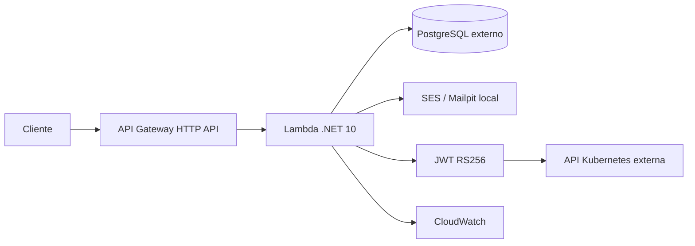

# Tech Challenge · Lambda

Autenticação de clientes da oficina com **C# / .NET 10 e AWS Lambda**. Este é o repositório **1 de 4** da fase 3: valida CPF, consulta existência e status no PostgreSQL e emite JWT para as APIs protegidas da aplicação principal.

O cliente confirma um código enviado ao e-mail já cadastrado antes de receber o JWT. O CPF identifica o cadastro; o código comprova acesso ao contato. Localmente, o e-mail fica no Mailpit.

## Arquitetura



**Neste repositório:** Lambda, API Gateway de autenticação, IAM da função, logs, métricas, testes e CI/CD. Banco gerenciado, rede, cluster Kubernetes e ordens de serviço pertencem aos outros repositórios.

## Estrutura

```text
.github/workflows/main.yml     CI/CD de homologação e produção
src/TechChallenge.Lambda/      Function, CPF, autenticação, JWT e adaptadores
tests/TechChallenge.Lambda.Tests/  Testes unitários, segurança e PostgreSQL
infra/                        Terraform e SQL de referência
scripts/                      Empacotamento, smoke e demonstração local
docs/                         Arquitetura, contratos e decisões
```

Tecnologias: .NET 10, AWS Lambda, API Gateway HTTP API, Npgsql/PostgreSQL, JWT RS256, Secrets Manager, SES, CloudWatch, Terraform, GitHub Actions e xUnit. Versões NuGet fixadas em `csproj` e `packages.lock.json`.

## Executar localmente

Pré-requisitos: SDK .NET 10, Docker Compose; `curl` e `jq` para os testes HTTP.

```bash
dotnet restore --locked-mode
dotnet run --project src/TechChallenge.Lambda -- --bootstrap
docker compose up -d --build
bash scripts/smoke.sh http://localhost:8080
bash scripts/e2e.sh
```

API: `http://localhost:8080`. Caixa de e-mail simulada: `http://localhost:8025`.
O bootstrap cria `.env` e uma chave RSA local em `.local`, preservando arquivos existentes. Ambos são ignorados pelo Git. Os containers não enviam mensagens reais.

Para executar a função diretamente pelo adaptador HTTP .NET:

```bash
docker compose up -d postgres mailpit
set -a
. ./.env
set +a
dotnet run --project src/TechChallenge.Lambda
```

### Autenticação

```bash
curl -X POST http://localhost:8080/auth/login \
  -H 'Content-Type: application/json' \
  -d '{"cpf":"52998224725"}'
```

Retorna `202` com `challenge_id`. Abra o Mailpit e use o código recebido:

```bash
curl -X POST http://localhost:8080/auth/verify \
  -H 'Content-Type: application/json' \
  -d '{"challenge_id":"SUBSTITUA_PELO_ID","code":"CODIGO_DE_6_DIGITOS"}'
curl http://localhost:8080/auth/me -H 'Authorization: Bearer SEU_TOKEN'
```

O seed contém apenas dados de demonstração: `52998224725` ativo e `11144477735` inativo. Clientes inexistentes/inativos recebem a mesma resposta inicial, sem envio de e-mail.

## Testes

```bash
dotnet test
TEST_DATABASE_CONNECTION='Host=localhost;Port=5434;Database=auth;Username=auth;Password=local-only-password' \
  dotnet test --collect:'XPlat Code Coverage' --results-directory TestResults
dotnet format --verify-no-changes
```

Sem `TEST_DATABASE_CONNECTION`, os testes PostgreSQL ficam explicitamente ignorados. Com a variável, cada teste cria e remove somente seu próprio schema temporário.

## Deploy e integração

A pipeline valida PRs e empacota a função. Push em `develop` implanta em `homolog`; push em `main`, em `production`, após as proteções configuradas no GitHub e ativação da variável de repositório `AWS_DEPLOY_ENABLED=true`. Até a configuração da AWS, apenas o CI executa. AWS OIDC evita chaves estáticas.

**Não há deploy AWS confirmado.** Configuração de conta, segredos, rede, ambientes e proteção das branches está descrita em [deploy](docs/deploy.md). Links de homologação/produção serão os outputs do Terraform após a implantação real.

- [Arquitetura e diagramas](docs/architecture.md)
- [Contrato com banco e aplicação .NET](docs/integration.md)
- [OpenAPI / Swagger](docs/openapi.yaml) — importe no Swagger Editor ou Postman.
- [ADRs e RFCs](docs/decisions.md)
- [Deploy, validação e pendências](docs/deploy.md)

Para encerrar: `docker compose down`. O volume do banco é preservado. Artefatos, caches e segredos locais não fazem parte da entrega versionada.
