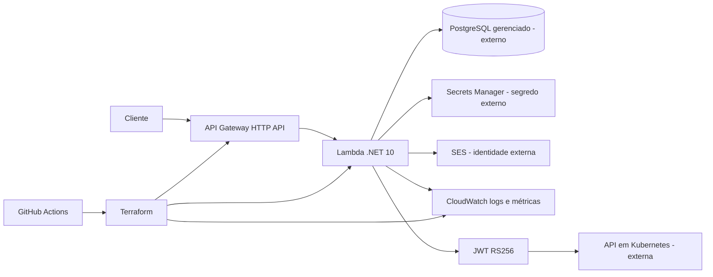
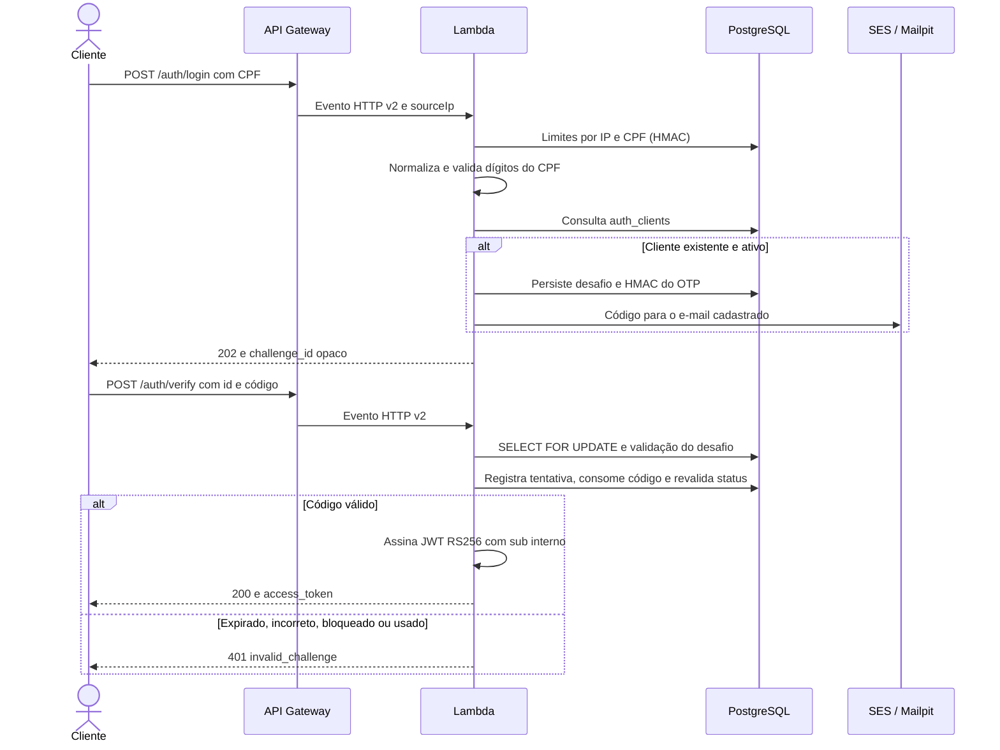
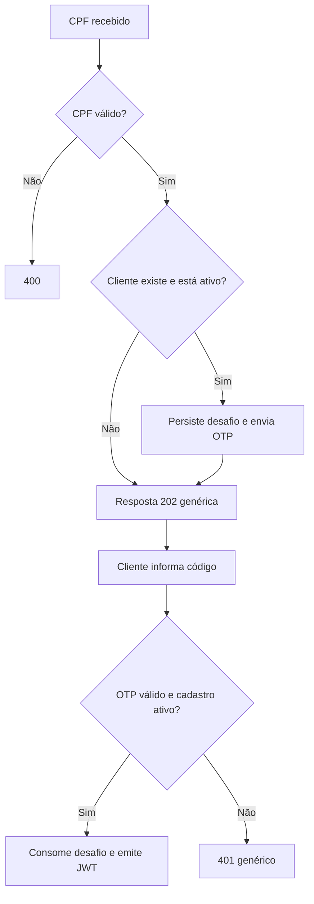
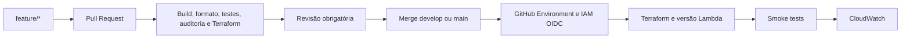
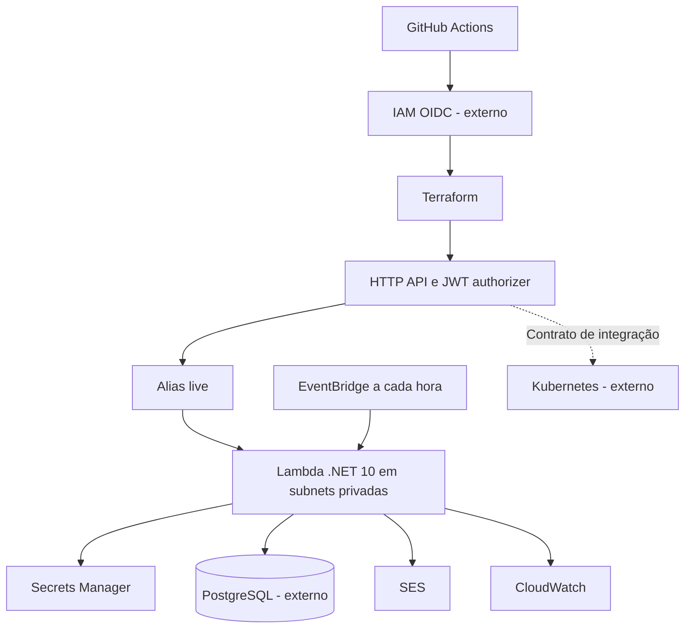
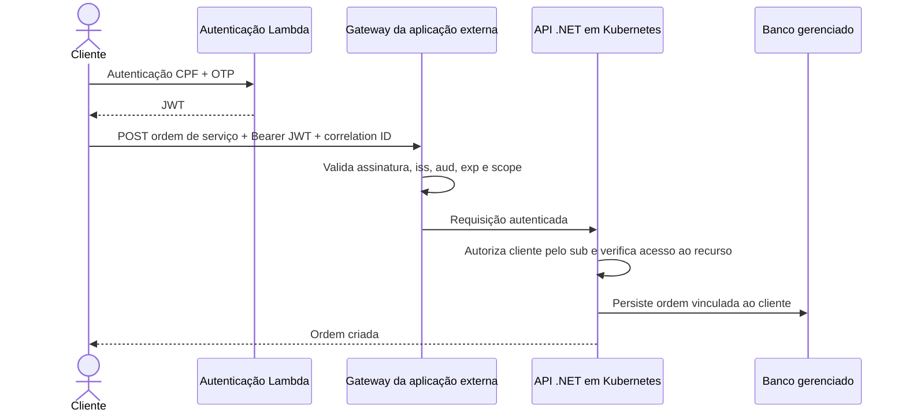
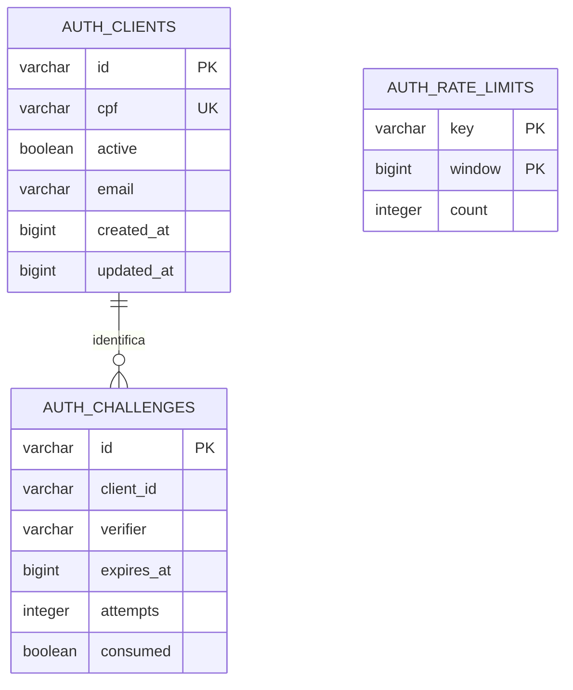

# Arquitetura da autenticação

## Escopo

O monólito .NET foi dividido em quatro responsabilidades de repositório, não em quatro serviços de negócio: autenticação Lambda, infraestrutura Kubernetes, infraestrutura do banco gerenciado e aplicação principal. Este repositório implementa somente a primeira responsabilidade e seu API Gateway de autenticação.

A função recebe eventos HTTP API v2 em `TechChallenge.Lambda::TechChallenge.Lambda.Function::FunctionHandler`. `AuthService` coordena CPF, persistência e notificação; `IClientRepository` e `INotifier` permitem trocar o banco/provedor sem alterar o fluxo. Um projeto .NET é suficiente para esse escopo; não foram reproduzidas todas as camadas do monólito.

## Componentes

Terraform define recursos; o diagrama não indica que já estão publicados. Em desenvolvimento, Docker substitui PostgreSQL gerenciado por PostgreSQL local e SES por Mailpit.

## Sequência de autenticação

OTP: seis dígitos aleatórios, cinco minutos, até cinco tentativas, uso único. HMAC vincula código ao desafio. A transação PostgreSQL confirma tentativas incorretas, evitando que rollback reabra tentativas. O bloqueio de linha impede duas emissões concorrentes para o mesmo desafio.

## Fluxo

## Infraestrutura e entrega

Reserved concurrency padrão 5 e pool Npgsql de até 2 conexões por ambiente de execução. O grupo deve dimensionar conexões e avaliar RDS Proxy. A função não cria VPC, RDS, cluster, DNS nem identidade SES. O agendamento remove desafios expirados e janelas antigas de rate limit.

## Abertura de ordem de serviço — integração externa

Este repositório implementa emissão e uma rota de demonstração protegida (`/auth/me`). A abertura de OS, autorização por propriedade, regras de negócio, dashboards de ordens e tracing da aplicação são responsabilidades da API principal.

## Modelo de referência

`auth_clients` é tabela apenas no ambiente local; em produção, pode ser uma view sobre o cadastro existente. A associação com desafios é lógica, sem FK para uma view de outro repositório. CPF normalizado tem índice único na origem; desafios possuem índice de expiração; `(key, window)` é a chave composta do limitador. Epoch UTC evita ambiguidades de fuso em expiração.

PostgreSQL oferece transações e bloqueio de linha para consumo único do OTP. É a referência de integração, sujeita ao acordo do grupo. O cadastro antigo possui `Documento`/`TipoDocumento` e **não possui status ativo nem datas de cadastro na entidade Cliente inspecionada**: não se deve inventar um status ativo padrão. O contrato deve ser implementado pelo responsável pelo banco/aplicação.
